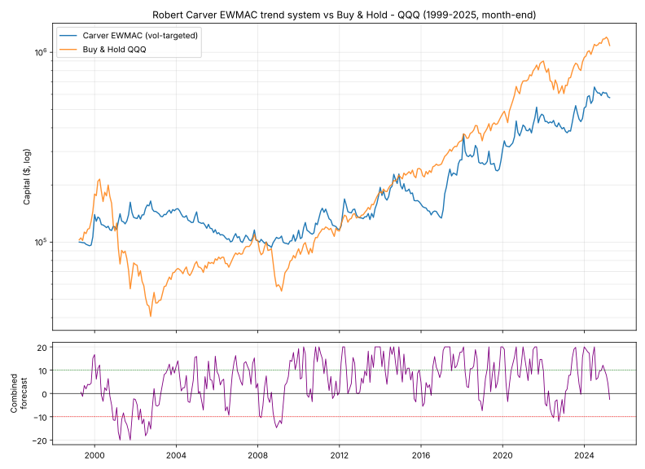

# Backtesting Robert Carver's CTA system on QQQ

A from-scratch, faithful implementation of **Robert Carver's systematic
trend-following ("CTA") framework**, applied to the **Invesco QQQ** ETF — plus a
series of honest experiments built on top of it (simple MA rules, leveraged-ETF
rotation, and options strategies priced with real implied volatility).

Carver — ex-AHL portfolio manager, author of *Systematic Trading* and *Advanced
Futures Trading Strategies*, and writer of the blog
**[This Blog is Systematic](https://qoppac.blogspot.com)** — builds trading
systems as a **staged, volatility-normalised pipeline**. This repo implements
that pipeline and runs it on 26 years of QQQ history (1999–2025).

> 📒 The methodology is written up from his blog/books/code in
> [`notes/carver_cta_framework.md`](notes/carver_cta_framework.md). Read that
> first if you want the "why".

---

## The pipeline

```
price ─► volatility σ ─► EWMAC rules ─► scale & cap (±20) ─► combine (+FDM) ─► vol-target sizing ─► position
```

| Stage | File | What it does |
|-------|------|--------------|
| 1. Volatility | `carver/vol.py` | EW std of daily price changes (span ~35), with a robust floor |
| 2–3. Rules | `carver/rules.py` | EWMAC = fast EWMA − slow EWMA, vol-adjusted, × forecast scalar, capped at ±20 |
| 4. Combine | `carver/forecast.py` | Weighted average of EWMAC speeds × Forecast Diversification Multiplier |
| 5. Sizing | `carver/position.py` | Volatility targeting → position in shares |
| Glue + P&L | `carver/system.py` | Wires it together and books a costed backtest |

**Forecasts** are scaled so `+10` = an average-strength long, `−10` = average
short, capped at `±20`. **Position size is proportional to the forecast** and
inversely proportional to volatility, so the system targets *constant risk*, not
a constant dollar position.

### Why EWMAC-only for an ETF?
Carver's other core rule, **carry**, needs a futures term structure / financing
spread that a plain cash ETF doesn't have, so this project uses the **EWMAC
trend ensemble** — the honest core of the system for a single ETF. The default
ensemble is the slower, cost-appropriate set **{8/32, 16/64, 32/128, 64/256}**
with equal forecast weights. Carver's published forecast scalars are baked in
(`EWMAC_FORECAST_SCALARS` in `carver/rules.py`).

---

## Quick start

```bash
pip install -r requirements.txt
python run_qqq.py
```

### Change settings in ONE place: `config.yaml`
All the knobs live in **`config.yaml`** with plain-English notes — no jargon
needed. Edit the numbers, save, re-run. The "everyday" knobs are:

| In the file | What it does |
|---|---|
| `capital` | how much (pretend) money to trade |
| `risk_level` | **how wild the ride is** — 0.10 calm → 0.40 aggressive |
| `reaction_speed` | `fast` / `balanced` / `slow` — how quickly it chases trends |
| `cost_bps` | assumed trading cost per trade |

An `advanced:` section exposes the exact Carver internals (EWMAC speed pairs,
volatility lookback) for when you want full control.

```
python run_qqq.py                            # uses config.yaml
python run_qqq.py --source yfinance          # fresh data to today (needs network)
python run_qqq.py --source my_prices.csv     # your own date,close CSV
python run_qqq.py --vol-target 0.25          # quick one-off override (skips the file)
pytest -q                                    # sanity tests
```

---

## Results (1999-03 → 2025-03, default config, net of 1bp costs)

| | CAGR | Ann.Vol | **Sharpe** | **Max Drawdown** | Skew |
|---|---|---|---|---|---|
| **Carver EWMAC** (vol-targeted) | 7.1% | 24.7% | 0.40 | **−44%** | −0.98 |
| Buy & Hold QQQ | 9.8% | 27.4% | 0.48 | −83% | +0.19 |



**The point isn't to beat buy-and-hold on raw return** — over a 26-year window
dominated by one of history's great bull markets in tech, full-time long
exposure is hard to beat. What the trend system buys you is **risk control**: it
went short as the forecast fell to −20 during the 2000–02 dot-com collapse and
2008, **roughly halving the maximum drawdown** (−44% vs −83%) and producing a
far smoother early-decade ride. That is exactly the behaviour Carver's framework
is engineered to deliver.

---

## The experiment ladder (one script per question)

Each later script answers a question the previous one raised. All use an
authentic ledger (integer shares/contracts, $3/trade, daily-NAV drawdowns)
and an in-sample / out-of-sample split at 2012-03-10.

| Script | Question | Headline answer |
|---|---|---|
| `simple.py` | Carver stripped to one signal + 4 settings? | Same character, far simpler; incl. Carver's buffering (AFTS) |
| `ema_cross.py` | The simplest CTA — a 50/200 cross? | Beats B&H: 11.3% CAGR, −39% maxDD, 29 trades/26y |
| `compare.py` | Side-by-side + drawdown *timing* (HWM→bottom→recover) | B&H was ~15y underwater; trend cuts it to ~10y |
| `robustness.py` | Is the edge overfit? (grid / OOS / bootstrap) | Robust region, holds OOS, Sharpe CI > 0 |
| `ema_sweep.py` | Which speeds minimise time underwater? | Slow-ish (slow MA ~150) recovers fastest |
| `monthly_ma.py` | Faber-style monthly MA(11) filter? | Sharpe 0.62, −36% maxDD (daily NAV), ~1.5 trades/yr |
| `backtest_authentic.py` | Real ledger + IS/OOS on the monthly rule | Regime split: wins the crash era, trails the 2012+ bull |
| `is_oos_ratio.py` | Best in/out-of-sample ratio (30y spliced NDX)? | ~70:30; conclusion stable across all ratios |
| `trend_vol.py` | Moreira-Muir vol targeting + 1.5x margin | 11.5% CAGR, 1.68M HKD vs 1.08M B&H, −40% maxDD |
| `leveraged_rotation.py` | Leverage without margin (QLD/TQQQ rotation) | QQQ+QLD mix: 2.55M HKD, −46% maxDD (calibrated vs real TQQQ) |
| `putwrite_vxn.py` | QQQAI-style VXN put-selling + tail hedge | Defensive claims replicate (Sharpe ≤1.28, −8% maxDD, crash-positive); upside capped ~5-6% CAGR |
| `riskrev_vxn.py` | Can put-premium-funded calls beat rallies? | No: ~15-20% rally capture — "beat rallies + protection + income" can't coexist at fair prices |

## Data

- `data/QQQ.csv` — split-adjusted daily **open,close** for QQQ,
  1999-03-10 → 2025-03-11 (MacroTrends export, ~6,540 rows). Bundled so
  everything runs offline. `data_loader.py` can instead pull fresh data
  (yfinance / Nasdaq API / your own CSV) on a machine with open network access.
- `data/VXN_spliced.csv` — real CBOE VXN (Nasdaq-100 implied vol) 2001–2025
  from two cross-validated sources (mean abs diff 0.002); pre-2001 proxied by
  VIX×1.17. Used to price options at *market* implied vol, not assumed premia.
- `data/QQQ_NDX_spliced.csv` — ^NDX index scaled onto QQQ at the 1999 junction
  (a proxy series for 30-year validation only).
- `data/QQQ_TQQQ_2010_2021.csv` — real TQQQ prices used to calibrate the
  leveraged-ETF synthesis (beta 2.95, corr 0.9985, drag 3.23%/yr).

## Layout

```
carver/            the framework (vol, rules, forecast, position, system)
data/              bundled datasets (see above)
data_loader.py     csv / yfinance / nasdaq loaders
run_qqq.py         CLI: run the Carver backtest, print stats, plot
config.yaml        plain-English control box for run_qqq.py
tests/             pytest sanity checks
notes/             study notes on Carver's method
*.py (top level)   the experiment ladder, see table above
```

## Caveats / not investment advice
Single-instrument backtests on a surviving, winning index; dividends ignored
(~0.6%/yr, conservative); leveraged-ETF prices are calibrated synthetics;
options backtests are Black-Scholes at real implied vol (research-grade, not
exchange-quote accurate); past performance does not predict future results.
This is an educational project, **not** investment advice.
